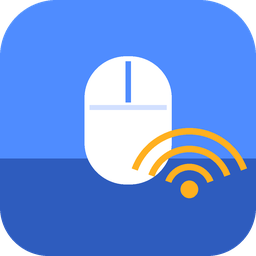
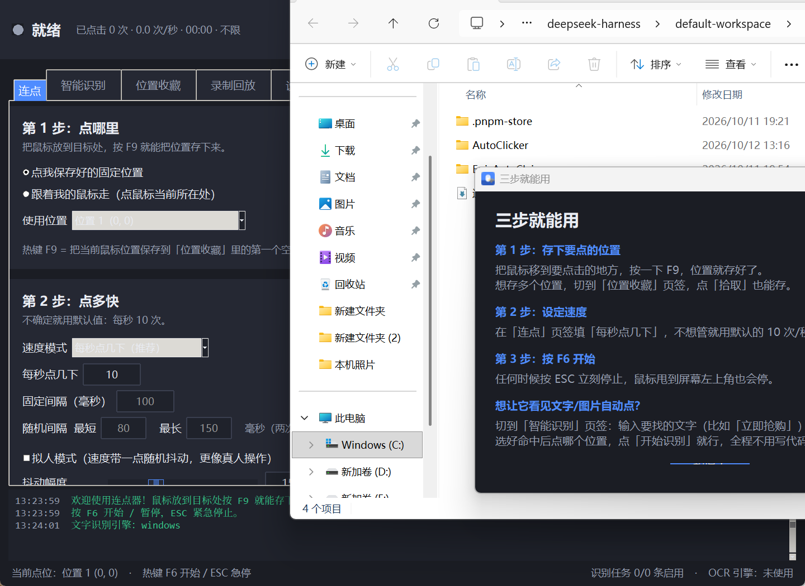
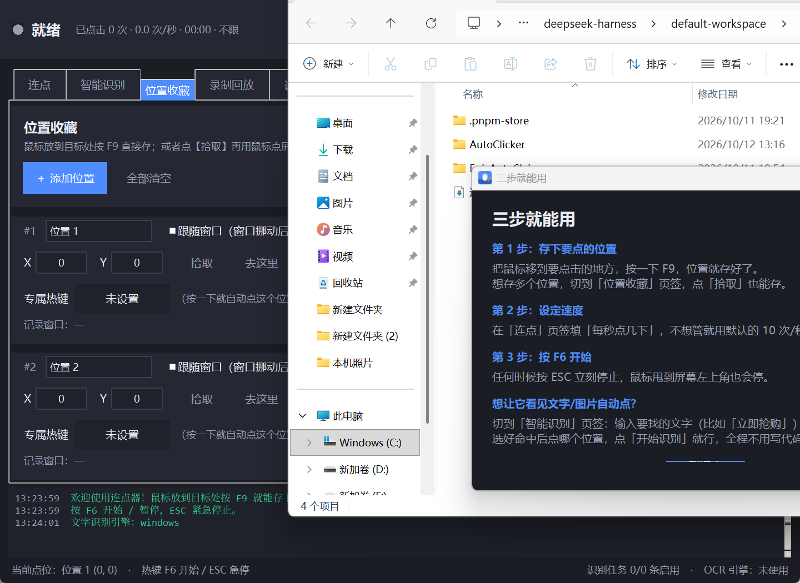
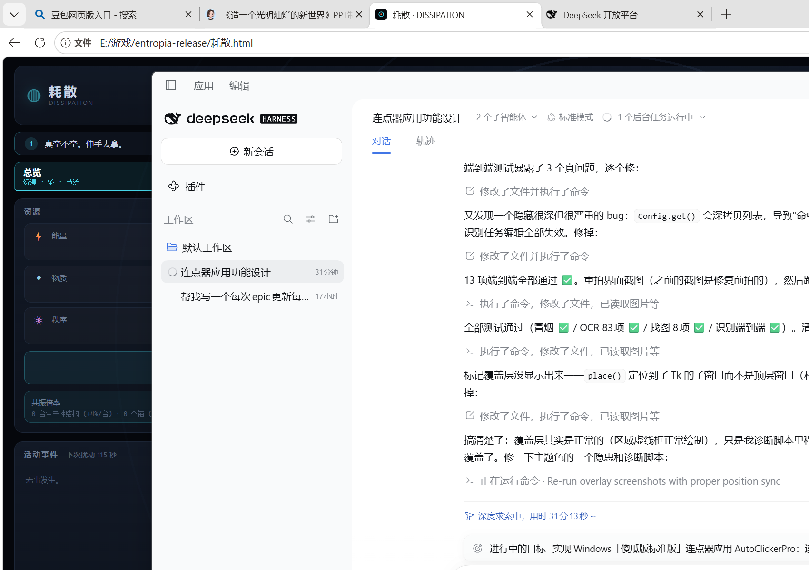
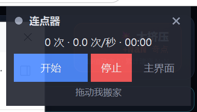
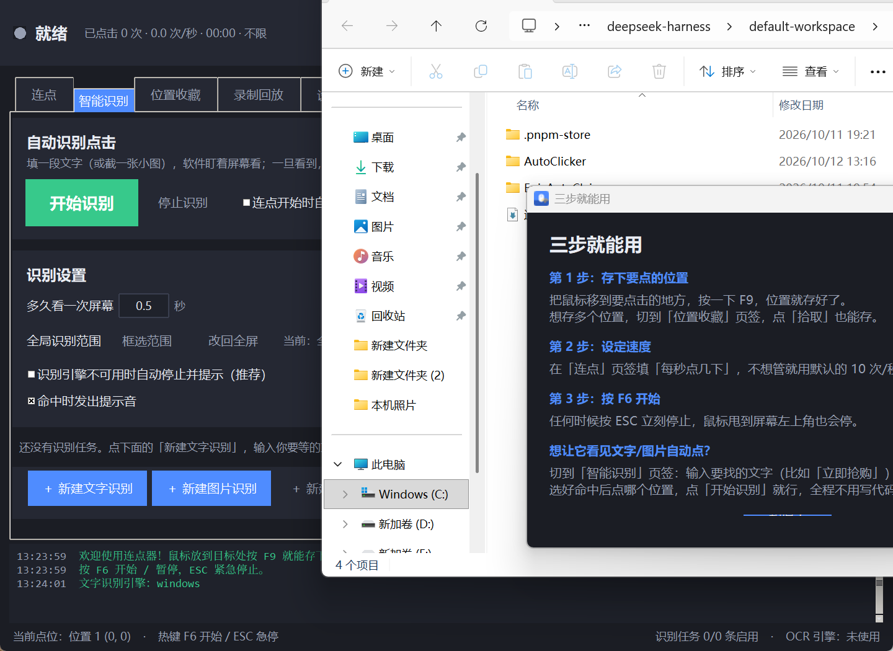
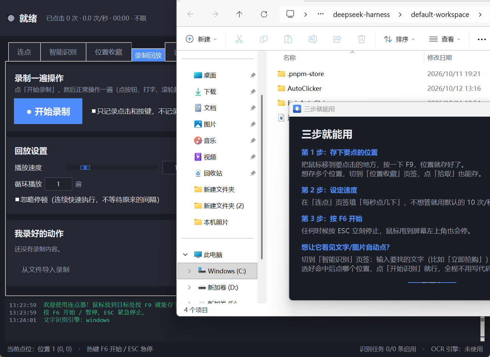

# 连点器 AutoClicker Pro 使用说明

> 免安装、纯本地运行、不联网、不上传任何数据。
> 全程点点点和填数字，不需要写一行代码。

---

## 一、怎么打开

1. 打开文件夹 **连点器**
2. 双击 **连点器.exe**
3. 如果双击没反应，就双击 **启动连点器.bat**（会多一个黑窗口，能看到出错原因）

第一次打开会弹一个「三步就能用」的小窗口，看完关掉即可。

> 想放到桌面：右键 **连点器.exe** → 发送到 → 桌面快捷方式。
> 想换地方：整个「连点器」文件夹一起复制走就行，配置会跟着走。

---

## 二、三步就能用（最常用玩法）

### 第 1 步：告诉它点哪里

把鼠标移动到你要点的位置（比如游戏里的某个按钮），然后按一下键盘上的 **F9**。
界面下方会提示「已保存位置……」，位置就存好了。

### 第 2 步：设置速度

在「连点」页的 **每秒点几下** 里填数字，比如：

- 抢购、抢票：填 **20** 到 **50**
- 游戏挂机、签到：填 **1** 到 **5**
- 办公重复点击：填 **2** 到 **10**

不确定就用默认的 **10**。

### 第 3 步：按 F6 开始

按 **F6** 开始（再按一次暂停），界面右上角的按钮也能点。

**任何时候想停**，按 **ESC**，或者把鼠标一下甩到屏幕**左上角**，两个都是万能急停。

---

## 三、位置收藏（存很多个点位）

切到「位置收藏」页，每个点位是一张卡片。

- **F9 快速存点**：鼠标放好按 F9，会存到第一个空位置
- **拾取**：点一下按钮，然后鼠标移到目标处**点一下**，就取到了（新手推荐这个）
- **去这里**：鼠标立刻移动过去，但**不点击**，用来检查位置对不对
- **测试点击**：移过去并**真的点一下**
- **设为当前目标**：让「连点」页用这个点位
- **跟随窗口**：勾上以后，点位记成窗口内的相对坐标。以后窗口移动了、拉大了，点击位置会**自动跟着变**，不会点空
- **专属热键**：给这个点位单独设一个键（比如 F1），以后按 F1 就直接点这个位置

> 每个位置都可以改名字，改完自动保存。关掉软件也不会丢。

### 屏幕上的标记（很好用，建议开）

在设置里勾上「在屏幕上显示位置标记」以后，屏幕上会直接画出来：

- **绿色十字 + 名字**：你存好的位置（当前正在用的那个是绿色，其它是灰色）
- **蓝色虚线框**：识别范围

### 迷你悬浮面板

点右上角的「迷你面板」，会出现一个半透明小窗：只有开始/停止和实时计数，可以拖到任何地方，永远在最前面。

---

## 四、智能识别：看到文字 / 图片就自动点（重点功能）

这是本次新增的核心功能：**你在框里输入一段文字（或者截一张小图），软件盯着屏幕看，一旦看到，鼠标就自己跑过去点你指定的位置。**

切到「智能识别」页 → 点 **＋ 新建文字识别**。

### 4.1 找文字（OCR）

1. 在 **要找的文字** 框里打字，比如 `立即抢购`
2. 一行一个，可以写多个（比如 `立即抢购` 和 `马上抢`，出现任意一个就会触发）
3. **找到以后** 选：
   - **点击我保存好的位置** — 点你之前存好的点位（推荐，最稳）
   - **直接点识别到的地方** — 点文字本身所在的位置，还能用「微调横向/纵向」偏移几个像素
4. **命中后休息** 填 3 秒，防止疯狂连点同一个按钮
5. 点 **测试识别** —— 屏幕上会画出红框告诉你找到没有
6. 都对了以后点 **开始识别**

> **识别范围**：默认全屏。如果屏幕上同样的字太多，点 **框选范围**，在屏幕上拖一个方框，只在这个范围里找。
> 范围越小，识别越快越准。

### 4.2 找图片（截图对比）

比找文字更快更准，适合按钮、图标、道具。

1. 点 **截图取图**，然后在屏幕上把那个按钮**框起来**
2. 模板就存好了（可以加多张）
3. **相似度** 默认 85%，找不到就往左拉一点（比如 75%）

### 4.3 找颜色

填 R、G、B 三个数字，或者点 **从屏幕取色** 直接在屏幕上点一下取色，再调「容差」。
适合判断血条、进度条、某个色块出现没有。

### 4.4 识别设置

- **多久看一次屏幕**：默认 0.5 秒。想反应更快填 0.2，想让电脑更省力填 1.0
- **全局识别范围**：给所有任务统一限定范围
- **连点开始时自动一起启动识别**：勾上以后，按 F6 就会连点 + 识别一起跑
- **命中时发出提示音**：听到「叮」一声就知道抓到了

> 注意：识别是**只读屏幕**，不会抢你的鼠标。只有真的命中时才会动鼠标去点一下。

---

## 五、录制回放

不想一条条设参数？让它学你操作一遍。

1. 点 **● 开始录制**
2. 正常操作一遍：点按钮、打字、滚轮
3. 回来点 **■ 停止录制**
4. 列表里出现一条录制，点 **▶ 回放** 就能重放

- **播放速度**：1 倍速和你当时一样快，2 倍速快一倍
- **循环播放**：填 10 就重放 10 遍
- **忽略停顿**：勾上以后不等待原来的间隔，飞快执行
- **只记录点击和按键**：勾上以后不记鼠标移动路径，更干净

---

## 六、热键一览（都能改）

| 按键 | 作用 |
|---|---|
| **F6** | 开始 / 暂停连点 |
| **F7** | 单击一次（点一下目标位置） |
| **F8** | 倒计时 3 秒后开始 |
| **F9** | 把当前鼠标位置存成点 |
| **F10** | 显示 / 隐藏主界面 |
| **ESC** | 紧急停止（万能急停） |
| **Ctrl+Alt+Q** | 退出程序 |
| **鼠标侧键 X2** | 按住期间持续连点，松开即停 |

改法：切到「设置」页 → 全局热键 → 点一下右边的按钮 → **直接按你想用的键**（鼠标侧键也可以）。

---

## 七、安全提示（建议看一眼）

- **急停一定记得**：ESC 键，和鼠标甩到屏幕左上角
- **速度别一上来就拉满**：超过 50 次/秒会弹确认框，太快的连点有可能让某些程序卡住
- **只在前台窗口点击**：在「连点」页的高级设置里。勾上并填上目标窗口标题后，只有那个窗口在最前面时才会点，你在别的窗口打字不会被乱点
- **后台点击**：勾上以后不抢鼠标，你还能一边点一边用电脑。但**部分程序（尤其游戏）不支持**，试了没反应就取消勾选
- **点击没反应的两种情况**：
  1. 目标程序是**以管理员身份运行**的，那连点器也要以管理员运行。设置页有「以管理员身份重启」按钮
  2. 游戏用了反作弊/独占输入，需要在目标程序里把「以管理员运行」关掉，或者改用「后台点击」

---

## 八、常见问题

**问：识别文字没找到，怎么办？**

1. 先点「测试识别」，看提示里「这一屏识别到的文字」是什么——如果识别到的文字缺字、错字，说明那块字太小，把**识别范围**框小一点会准很多
2. 确认要找的文字没有多余空格（程序默认忽略空格，一般不用管）
3. 屏幕缩放如果特别大（比如 200%），可以把系统缩放调到 150% 再试

**问：文字识别一直提示「引擎不可用」？**

说明系统的中文识别组件没装。可以先用「找图片」功能，效果一样好，而且不需要 OCR。
装法：Windows 设置 → 时间和语言 → 语言 → 添加语言 → 中文（简体）→ 勾上「光学字符识别」。

**问：鼠标自己动了，我抢不过来怎么办？**

按 ESC，或者把鼠标甩到屏幕左上角。急停之后鼠标完全归你。

**问：关闭窗口后程序不见了？**

默认是**最小化到托盘**了，看屏幕右下角时间旁边的小图标，双击它就能打开。想彻底退出：托盘图标右键 → 退出程序。
不想要这个行为：设置页 → 通用 → 取消勾选「关闭窗口时最小化到托盘」。

**问：怎么让它到点自动开始？**

设置页 → 计划任务 → 勾选「启用计划任务」，选「每天固定时间」，填 `09:00`，再填运行多少分钟后自动停。

**问：设置乱了想恢复？**

- 热键：设置页 → 恢复默认热键
- 全部：设置页 → 配置档 → 「另存为」保存一份，乱了一键切回来
- 彻底重置：关掉程序，删掉 `config` 文件夹里的 `settings.json`

**问：怎么卸载？**

直接删除整个「连点器」文件夹。它是绿色的，不写注册表（除非你勾了开机自启，那就在设置页取消勾选）。

---

## 九、文件夹里都有什么

- **连点器.exe** — 主程序，双击这个
- **启动连点器.bat** — 备用启动方式（能看到报错信息）
- **app** — 程序源码（想加功能时用，平时不用管）
- **runtime** — 自带的 Python 运行环境（不用自己装任何东西）
- **config** — 你的所有设置、存好的位置、截的模板图（**要备份就备份这个文件夹**）
- **docs/screenshots** — 界面截图
- **使用说明.md / 使用说明.html** — 就是这份说明

---

*祝你点得开心。记得 ESC 是万能急停。*
